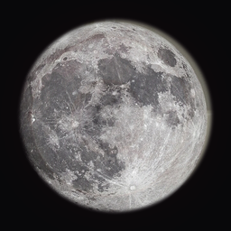
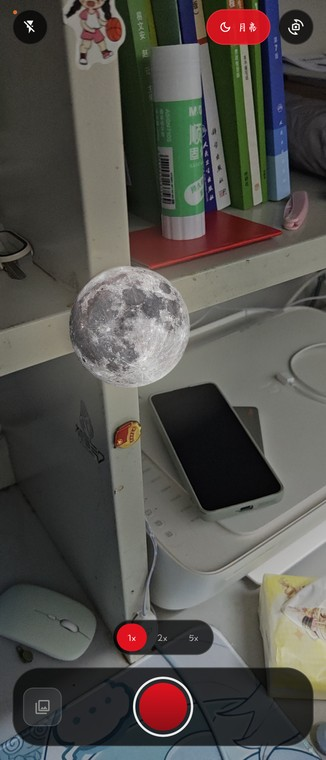
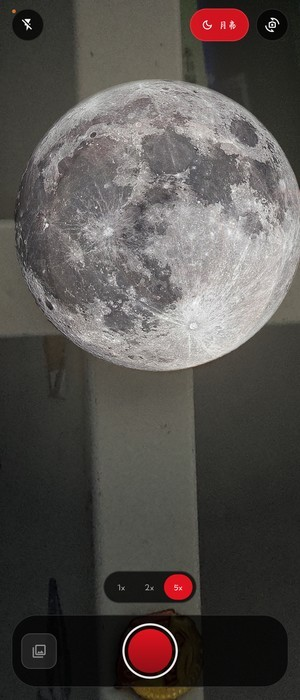

<p align="center">
  
</p>

<h1 align="center">借月 · BorrowMoon</h1>

<p align="center">把画面里的圆形光源，变成一轮月亮。</p>

<p align="center">
  
  
</p>

---

## 这是什么

一个玩笑性质的 Android 相机。

初始画面和普通相机**完全一样**。当你**点屏幕对焦**，或把画面**放大到 1.35x 以上**时，画面里离你点击位置最近的圆形光源会变成一轮月亮；继续放大，月亮会跟着等比放大，直到超出屏幕边缘。

不联网、不上传、不需要任何模型文件，所有处理都在本机实时完成。

## 特性

- **纯相机界面**：全屏预览 + 红黑玻璃控件，没有拍立得边框、没有相册墙
- **点击锁定**：点哪个光源锁哪个，只渲染这一个，不会满屏都是月亮
- **锁定即冻结**：锁定瞬间记录目标的归一化位置与半径，之后贴图大小只由变焦比推算，快速捏合也不会丢
- **超出画面不消失**：目标放大到只剩一部分时继续跟随，月亮同样被裁出屏幕
- **拍照也带月亮**：成片与预览位置、大小一致
- **白天自动跳过**：画面中位亮度 > 135 或过于平坦时不检测
- **零视觉依赖**：检测器约 300 行 Kotlin，没有 OpenCV / MediaPipe / TFLite

## 使用

1. 打开 App，对准灯、路灯或任何圆形发光物
2. 点一下屏幕完成对焦，月亮出现
3. 双指放大，月亮随变焦等比放大
4. 按快门保存（照片会同时写入系统相册）

8 秒不操作且未放大时，月亮自动收起，回到纯相机画面。

## 工作原理

```
Preview(4:3) ──► PreviewView(FILL_CENTER, 全屏)
              └► ImageAnalysis(4:3, 640×480, KEEP_ONLY_LATEST)

ImageAnalysis ─► MoonDetector ─► MoonTracker ─► 单目标锁定 ─► Compose 叠加层
                  （亮度连通域）    （EMA 平滑）    （几何缩放）      （辉光 + 月亮）
ImageCapture  ─► MoonComposer（离线把月亮烧进照片，与预览同参数）
```

**检测**：只读 YUV 的 Y 平面，降到 320×240；以 `max(P50 + 55, 150)` 做自适应阈值；连通域后按面积、宽高比、填充率、二阶矩过滤；最后用「圆内平均亮度 > 1.45r 环带 × 1.12」确认它真的在发光（这条同时兼容环形灯、带暗心的吸顶灯）。

**坐标**：`UseCaseGroup` + `ViewPort` 把 Preview 与 Analysis 的 FOV 锁成同一块；分析 buffer 开启 `setOutputImageRotationEnabled(true)`，与显示同向，叠层侧按 `FILL_CENTER` 的中心裁切公式换算。

**渲染**：Compose 叠层与 `PreviewView` 是两个独立图层，`BlendMode.Screen` 不生效，所以用「径向辉光 + 0.88 alpha 月亮」伪造发光感；拍照合成用同一套参数。

## 构建

需要 JDK 21（或 17+）与 Android SDK 36。

```bash
# 1. 配置 SDK 路径
echo "sdk.dir=/path/to/Android/Sdk" > local.properties

# 2. 构建
./gradlew assembleDebug
# 产物：app/build/outputs/apk/debug/app-debug.apk
```

若使用命令行 Gradle（非 wrapper），确保 `gradle.properties` 中的
`org.gradle.java.installations.paths` 指向本机 JDK。

## 已知限制

- **一次只锁一个目标**，换目标需要重新点击
- **5x 以上是数码变焦**，画面本身会糊（月亮贴图不受影响）
- **白天户外基本不触发**：这是刻意为之，夜景 / 室内灯才是目标场景
- 目标只剩很小一块时可能丢失锁定，8 秒后月亮收起

## 致谢

本项目基于 **[Genkaim/InstCam](https://github.com/Genkaim/InstCam)**（MIT License）再开发。

原项目是一款拍立得风格的 Android 相机。本仓库保留了它的 CameraX 接入方式、照片存储工具与整体工程结构，在此基础上：

- 新增 `MoonCameraScreen`（全新的全屏相机界面），旧 `CameraScreen` 保留但不再作为入口
- 新增 `moon/` 包：`MoonDetector` / `MoonTracker` / `MoonComposer`
- 新增 `MoonViewModel`：接入 `ImageAnalysis`、`ViewPort`、变焦与目标锁定
- 移除拍立得白框与相册首屏，拍照后直接写入系统相册
- 更换应用名（借月）、包名（`com.nairocy.borrowmoon`）与图标

原项目版权归 Genkaim 所有。

## License

[MIT](LICENSE)。衍生作品同样以 MIT 发布，并保留原作者的版权声明。
